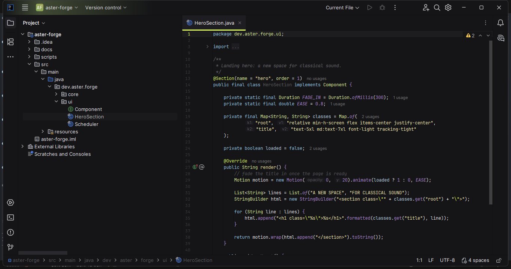
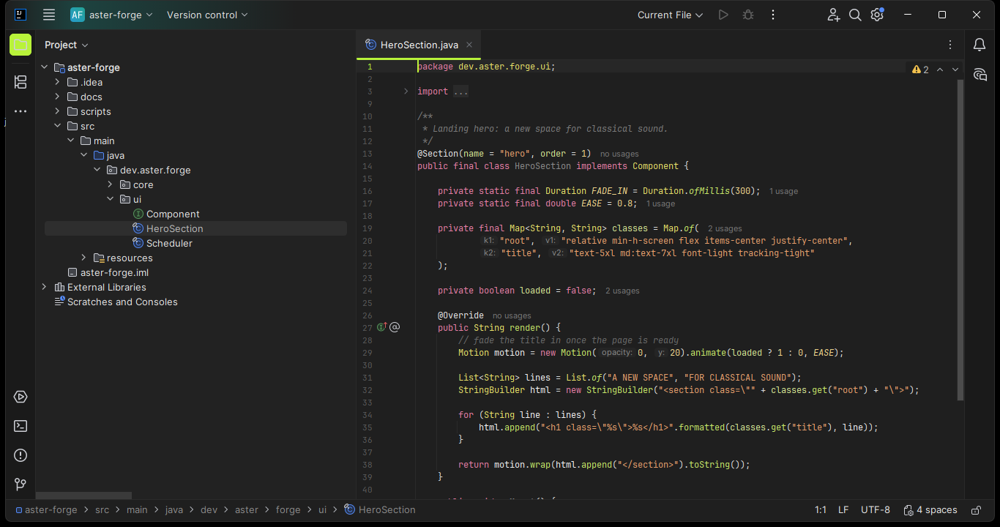
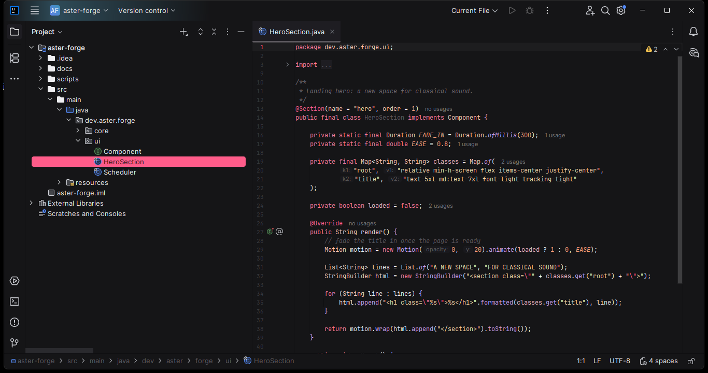
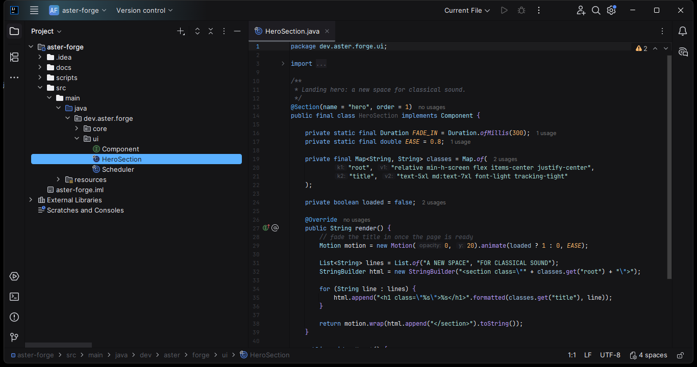
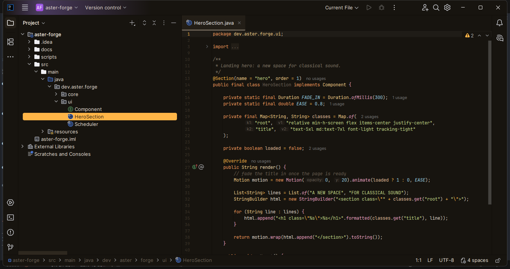
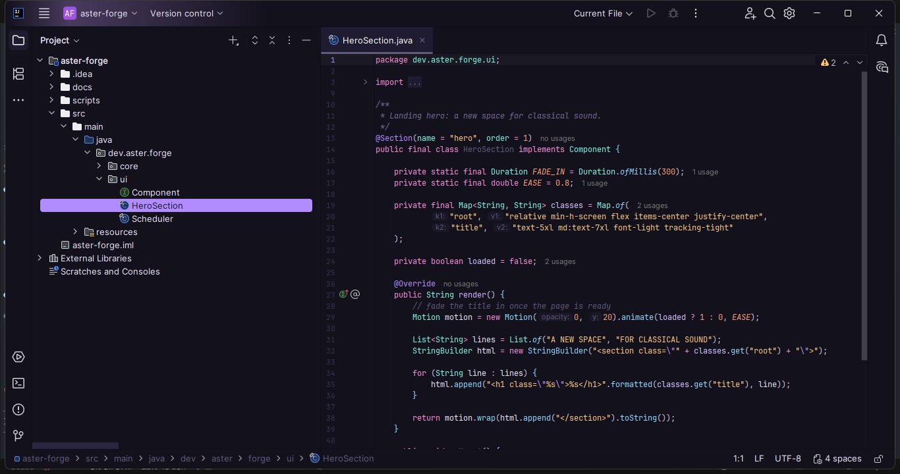
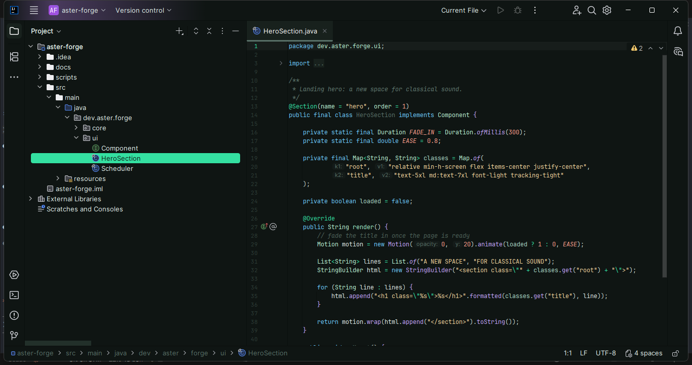
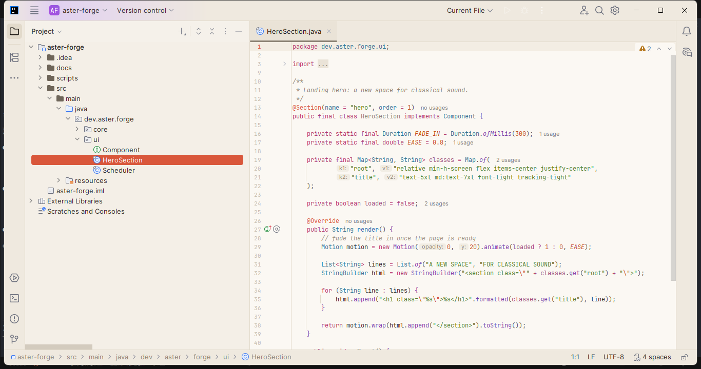

# Kuk Dev Themes

Seven dark themes and one light theme for JetBrains IDEs, inspired by Kuk, the Egyptian god of
primordial darkness. A companion to [NYX Dev Themes](https://github.com/urtaav/nyx-dev-themes).

[](https://ko-fi.com/urtaav)

## Themes

| Theme | Editor | Syntax |
|---|---|---|
| **Kuk** | `#151517` | Sky-blue keywords, pale lime types, soft yellow strings, lilac calls |
| **Kuk Neon** | `#1F1F1F` | Pink keywords, yellow types, peach strings, lime selected row |
| **Kuk Ember** | `#151517` | Rose-red accent, pink keywords, coral types, warm sand strings |
| **Kuk Abyss** | `#151517` | Ocean-blue accent, blue keywords, cyan types, aqua strings |
| **Kuk Amber** | `#17140F` | Warm night mode: honey accent, orange keywords, olive strings |
| **Kuk Nebula** | `#13111C` | Deep indigo, lavender accent, pink keywords, aqua types |
| **Kuk Jade** | `#0F1513` | Green-black, jade accent, sky keywords, sand strings |
| **Kuk Dawn** | `#FBF8F3` | Light: warm paper, terracotta accent, berry keywords |

Each theme ships its own UI theme (`*.theme.json`) and editor color scheme (`*.xml`).
Folders in the Project view are solid and light, and tree indent guides are hidden.
On every theme except Kuk the selected row takes the accent color and its text and icons follow it;
hovering a row shows a soft tint of the accent.

## Screenshots

### Kuk


### Kuk Neon


### Kuk Ember


### Kuk Abyss


### Kuk Amber


### Kuk Nebula


### Kuk Jade


### Kuk Dawn


## Palette (Kuk)

| Role | Color |
|---|---|
| Editor, sidebar, panels | `#151517` |
| Gutter | `#101012` |
| Selected row, active tab | `#1E1D22` |
| Accent | `#DCFB58` |
| Keywords | `#93C6E8` |
| Types | `#DDF39A` |
| Strings | `#F5EDB0` |
| Functions | `#F3E9A0` |
| Calls, braces, numbers | `#AB87D1` |
| Fields | `#B9D4E8` |
| Comments | `#55545A` |

## Install

From JetBrains Marketplace: **Settings → Plugins → Marketplace**, search **Kuk Dev Themes**.

From a ZIP: **Settings → Plugins → ⚙ → Install Plugin from Disk…** and pick the file in `build/distributions/`.

Then go to **Settings → Appearance & Behavior → Appearance** and select a Kuk theme.
If the editor scheme does not switch, select it under **Editor → Color Scheme**.

## Development

Requirements: JDK 21. Gradle is provided by the wrapper.

```
./gradlew buildPlugin   # ZIP in build/distributions/
./gradlew runIde        # sandbox IDE with the themes loaded
```

Palettes live in `tools/generate_themes.py`. Edit them there and regenerate instead of
editing the JSON/XML by hand, so all themes keep the same keys:

```
python tools/generate_themes.py src/main/resources
```

Note: IntelliJ only loads `editorScheme` as a file when the path ends in `.xml`.

## Publishing

The first version must be uploaded manually at plugins.jetbrains.com. Later versions:

```
export PUBLISH_TOKEN=<set-in-env>   # Marketplace token, never commit it
./gradlew publishPlugin
```

## Support

Kuk is free. If it makes your code feel better, you can [buy me a coffee on Ko-fi](https://ko-fi.com/urtaav).

## License

[MIT](LICENSE)
